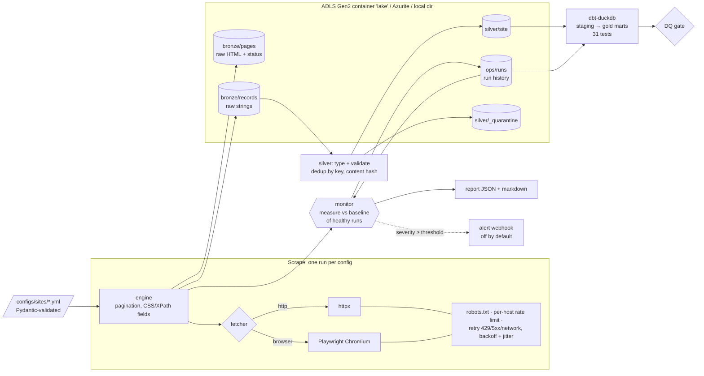

# scrapewatch

Config-driven web scrapers that notice when they break. Each site is one YAML file of selectors, and a generic engine
runs any of them over **httpx** or **Playwright**. It respects robots.txt, sends an identifying User-Agent, rate-limits
each host and retries with backoff and jitter. After every run a **monitor** compares the run with the site's recent
healthy runs and classifies what went wrong: crash, blocking (403/429, CAPTCHA, empty body), fetch errors, selector
breakage, layout or format drift, or a volume anomaly. Results land in a **bronze / silver / gold** lake on
**Azure Data Lake Storage Gen2** (Azurite locally, or the filesystem). Silver is typed, validated, deduplicated and
quarantined. Gold is built with **dbt-duckdb**. **Airflow** orchestrates it, and **Terraform** defines the Azure side.

It only scrapes sites built for scraping practice: [books.toscrape.com](https://books.toscrape.com) and
[quotes.toscrape.com](https://quotes.toscrape.com), including the JavaScript-rendered `/js/` pages. The test suite also
serves its own local catalogue site, which it can break on demand.



## Quickstart

Requires [uv](https://docs.astral.sh/uv/). uv installs Python 3.12 if needed.

```bash
make install            # uv sync --all-groups (runtime + dev + airflow)
make browsers           # Playwright Chromium headless shell (for fetcher: browser)
make test               # ruff + 81 pytest tests (~35 s), all offline
make faultbench         # 13 injected faults + 4 clean scenarios on the local site -> reports/faultbench.json
make run                # scrape all configs -> monitor -> silver -> dbt build -> DQ gate (lake: ./lake)
make bench              # the full pipeline twice on a fresh lake -> reports/bench.json (~4 min, real sites)
make tf                 # terraform fmt -check + init -backend=false + validate

# lake on Azurite instead of ./lake
make azurite            # (or: docker compose up -d azurite), then:
export SCRAPEWATCH_LAKE=az://lake AZURE_STORAGE_CONNECTION_STRING="<Azurite dev string from .env.example>"
uv run scrapewatch run
```

Single steps: `uv run scrapewatch {validate|scrape|silver|dbt|run} [site ...]`. `scrape` exits 2 if any run is
critical, and `run` exits 2 if the DQ gate fails. The latest report per site is written to `reports/latest-<site>.{json,md}`.

### Adding a site

Add one file to `configs/sites/`. Its name must match the `name` field. The schema is in `src/scrapewatch/config.py`.

```yaml
name: quotes_toscrape
start_urls: [https://quotes.toscrape.com/page/1/]
fetcher: http                         # or: browser (+ wait_for_css)
item_css: div.quote                   # or item_xpath
fields:
  text:       {css: "span.text", required: true}
  author:     {css: "small.author", required: true}
  author_url: {xpath: ".//a[contains(@href, '/author/')]/@href", absolute_url: true}
  tags:       {css: "a.tag", many: true}
  # also: attr, regex (first group), type: str|int|float
key_fields: [text, author]            # record identity for dedup
pagination: {next_css: "li.next a", max_pages: 20}
rate_limit: {requests_per_second: 2}  # per host, hard cap 10
retry: {max_attempts: 4, backoff_base_s: 0.5, backoff_max_s: 30}
monitor: {max_required_null_rate: 0.02, volume_low: 0.5}   # thresholds, all optional
```

Validation rejects unknown keys and selectors that set both or neither of css/xpath. It also rejects `key_fields` that
are not fields, configs with no required field (breakage detection depends on one), `wait_for_css` on an http fetcher,
non-http(s) URLs and rate limits above 10 rps. The Airflow DAG lists the configs at run time, so a new file becomes a
new mapped task without touching the DAG.

## How it works

| Step | Code | What it does |
|---|---|---|
| Fetch | `fetch.py` | Reads robots.txt per host, following RFC 9309: a 4xx means allow all, a 5xx or an unreachable file means disallow all, and `Crawl-delay` slows the limiter down. Every request carries a `scrapewatch/0.1 (+repo URL)` User-Agent and waits out a minimum interval per host. Only 429, 5xx and network errors are retried, with full-jitter exponential backoff. `Retry-After` acts as a floor and everything is capped. 403 and 404 are returned without a retry: hammering a block makes it worse, and the monitor needs to see it. `BrowserFetcher` swaps only the GET for Playwright, so robots, rate limiting and retries stay identical. |
| Extract | `engine.py` | Selects items, extracts each field as a raw string (or list), resolves relative URLs and follows the next link. It never raises for site problems. A crash is captured with its traceback so the monitor can classify it, and each page is tagged with a block reason. Typing is deliberately left to silver. |
| Monitor | `monitor.py` | Measures the run: status mix, retries, blocked pages, zero-item pages, per-field null rate, per-field type-error rate, and a DOM fingerprint (the set of `tag.class` tokens). Compares those with a baseline: the median of the last 5 runs that raised **no** issue. Writes the run to `ops/runs/` in the lake, plus a JSON and a markdown report, and optionally POSTs to a webhook. |
| Bronze | `pipeline.write_bronze` | `bronze/pages/site=…/dt=…/run_id=….parquet` holds raw HTML, status, attempts and a sha256 per page. `bronze/records/…` holds raw extracted strings as JSON. Both are zstd Parquet. |
| Silver | `silver.py` | Types every record with the config (regex, then int/float). A record with a missing required field or an unparseable value goes to `silver/_quarantine/<site>.parquet` with its reasons, and is never dropped. Valid records are deduplicated by `sha256(key_fields)`, keeping the latest, and tracked with `first_seen_at`, `last_seen_at`, `times_seen` and `content_versions` (a changed content hash). Silver is rebuilt from all bronze for the site, so it is idempotent. |
| Gold | `dbt/` | Staging views (`stg_books` maps the star-rating word to 1-5; `stg_quotes`; `stg_runs`) and marts (`mart_books_by_rating`, `mart_tag_popularity`, `mart_author_quotes`, `mart_scrape_health` from the run history). 31 dbt tests, including `assert_js_render_parity`, which fails if the Playwright-rendered `/js/` scrape and the static-HTML scrape disagree on a single quote. |
| Gate | `pipeline.step_gate` | Fails the run on any critical monitor finding, a quarantine rate above 5%, an empty silver table, or a failing dbt test. Warnings pass. |
| Orchestrate | `dags/scrapewatch_dag.py` | Airflow 3 TaskFlow: `sites` → `scrape.expand(site)` → `monitor.expand` → `load_silver` → `dbt_build` → `dq_gate`. The tasks are the same `pipeline.step_*` functions the CLI calls. `scrape` runs one at a time because two configs share `quotes.toscrape.com` and the rate limiter is per process. |

### Failure classes

Each class is triggered by a fault the test site can inject (`src/scrapewatch/testsite.py`):

| Class | Severity | Detected when | Injected fault(s) |
|---|---|---|---|
| `crash` | critical | the scraper raised | `crash_markup`: next link `http://[broken/…` makes URL parsing raise |
| `blocked` | critical | final status 403/429; or a 2xx page with too few items that contains challenge markers or is empty | `rate_limited` (persistent 429), `forbidden`, `captcha`, `empty_body` |
| `fetch_error` | critical | 5xx or network error after all retries | `server_error` (persistent 503) |
| `selector_breakage` | critical / warning | a 2xx, unblocked page yields no items; a required field is null in more than 2% of items; an optional field's null rate rises more than 10 points above baseline (warning) | `selector_rename`, `field_rename`, `optional_field_missing` |
| `schema_drift` | critical / warning | values are present but stop parsing (critical for a required field); DOM fingerprint Jaccard drops below 0.80 against the baseline while the selectors still match (warning, an early sign) | `price_format` (`£12,34`), `layout_drift` (re-skinned page) |
| `volume_anomaly` | warning | items fall outside 0.5×–2× the baseline median | `drop_items` (8 of 20 per page), `truncated_pagination` |

The checks report root causes, not symptoms. A blocked, crashed or failed run has fewer items too, but that does not
also raise a volume anomaly. A challenge page's DOM is left out of the layout fingerprint. Challenge markers are only
checked on pages that came back short of items, so a quote containing "access denied" cannot trip them. Runs that
raised any issue never enter the baseline, so a regression that persists keeps alarming instead of becoming the new
normal.

## Measured results

All numbers come from this repo's own commands, run on an Apple-silicon Mac on 2026-11-12. The source files are
`reports/bench.json`, `reports/faultbench.json` and the pytest output.

**Real scrape of the practice sites** (`make bench`: the full pipeline twice on a fresh lake)

| Site | Fetcher | Pages | Records | Run time (run 1 / run 2) | Retries | Monitor verdict (run 1 / run 2) |
|---|---|---|---|---|---|---|
| books.toscrape.com | httpx, 2 rps | 50 | 1,000 | 79.9 s / 81.4 s | 0 | ok / ok |
| quotes.toscrape.com | httpx, 2 rps | 10 | 100 | 10.2 s / 10.4 s | 0 | ok / ok |
| quotes.toscrape.com/js/ | Playwright, 1 rps | 10 | 100 | 21.3 s / 22.8 s | 0 | ok / ok |

| Pipeline | Value |
|---|---|
| End-to-end wall time per run (3 sites + silver + dbt + gate) | 118.9 s, 119.0 s |
| Bronze after 2 runs | 2,400 records, 140 page snapshots. 5,484,882 bytes of raw HTML stored as 450,117 bytes of zstd Parquet (≈12×) |
| Silver dedup after 2 runs | books 2,000 → 1,000; quotes 200 → 100; quotes_js 200 → 100. **1,200 duplicates removed**, 0 content changes |
| Quarantine | 0 of 2,400 records (the practice sites are clean; quarantine is exercised by the tests) |
| dbt build | 38 nodes, **31 / 31 tests pass**, including the parity check: all 100 Playwright-rendered quotes match the static scrape |
| DQ gate | passed, both runs |
| Run time is dominated by | the polite rate limit plus server latency (about 1.6 s per books page), not CPU (the bench used 9 s of user CPU in 4 min) |

**Failure detection on the local test site** (`make faultbench`: 3 clean baseline runs, then the fault)

| | Value |
|---|---|
| Injected faults detected with the correct class | **13 / 13** (9 critical, 4 warning) |
| Faults that also raised a wrong extra class | 0 / 13 |
| Clean runs that raised any issue (false positives) | **0 / 59**. These cover 39 baseline warm-ups, plus 5 runs each of: clean, transient 429 (retried twice per page), transient 503, +20% catalogue growth |
| Benchmark run time | 2.3 s |

During development the monitor also caught a real crash. The first Playwright run raised
`BrowserType.launch: Executable doesn't exist`, and the monitor recorded it as a critical `crash` with its traceback
instead of a silent zero-item run. The faultbench also caught one of the monitor's own bugs: a captcha page's DOM was
leaking into the layout fingerprint and raising a spurious `schema_drift` next to `blocked`. The fingerprint now skips
blocked pages.

**Tests:** 81 pytest tests, all passing in about 32 s. They cover config validation, fetch (backoff bounds,
retry-on-transient-only, `Retry-After`, robots allow/deny/5xx/crawl-delay, User-Agent, rate limiter), extraction,
Playwright on a local JS-rendered page, the full fault matrix and clean scenarios, baseline poisoning, webhooks,
dedup/versioning/quarantine, `dbt build` with a negative parity case, the gate, the DAG import, and two tests against
**Azurite**. The Azurite tests ran locally against Azurite 3 from npm and are skipped when nothing listens on
`127.0.0.1:10000`. A real `quotes.toscrape.com` scrape (100 records) was also written to Azurite, and silver was built
from it there. Two tests found real bugs during development: `mart_author_quotes` was counting tag rows instead of
quotes, and a warning-level run could slide into the baseline.

## Security

- **Secrets:** nothing secret is in the repo. The only key in it is Azurite's published development key. Production
  auth is Azure AD: `DefaultAzureCredential` with the Terraform-created user-assigned identity. The alert webhook URL is
  read from the environment (in Azure, a Key Vault secret), is never written into reports, and webhook failures log
  only the exception type.
- **Terraform (`terraform/`):** ADLS Gen2 (`is_hns_enabled`), `shared_access_key_enabled = false`, OAuth by default,
  `public_network_access_enabled = false`, a firewall that denies by default, TLS 1.2+, infrastructure (double)
  encryption, soft delete, and a lifecycle rule that moves raw HTML to cool storage at 30 days and deletes it at 180.
  Key Vault uses RBAC, purge protection and no public access. The pipeline identity gets **Storage Blob Data
  Contributor on the `lake` container only** and **Key Vault Secrets User**, with no account- or management-plane
  rights. Optional readers get Blob Data Reader on the container. Optional private endpoints cover blob, dfs and vault.
  The container is created through ARM (`storage_account_id`), so `apply` does not need data-plane network access.
- **Scraping hygiene:** robots.txt, an identifying User-Agent with a contact URL, a 10 rps hard cap per host, no retry on
  403, and no CAPTCHA solving or block evasion of any kind. A block is something to report, not something to get around.

## Limitations

- **Terraform was validated, never applied.** `terraform fmt -check` and `validate` pass with azurerm 4.x. No Azure
  subscription was used, so the role scopes, private endpoints and lifecycle rule have not been checked against real
  Azure.
- **Azurite is not ADLS Gen2.** Azurite implements only the Blob API, so the lake uses the Blob API, which ADLS Gen2
  also serves on the same data. The DFS endpoint and hierarchical-namespace semantics, such as atomic directory
  renames and POSIX ACLs, were not exercised.
- **dbt reads a local copy when the lake is on Azure.** `step_silver` mirrors silver Parquet to `warehouse/silver/`, and
  dbt-duckdb reads that copy. Reading `abfss://` directly through DuckDB's azure extension would remove the copy, but
  it is not implemented.
- **Docker and the CI workflow were not run here.** The build machine had no Docker daemon, so the `Dockerfile`,
  `docker-compose.yml` and the GitHub Actions workflow (which uses an Azurite service container) are written but not
  executed. Everything they do was run natively instead.
- **The Airflow DAG was import-tested, not scheduled.** The test loads it into a `DagBag` and checks its wiring. A real
  scheduler run did not happen.
- **The monitor is threshold-based.** The thresholds are per-site config, and the defaults were tuned on the fixture
  site and two clean practice sites. A noisy real site would need tuning, and a seasonal volume pattern would need a
  better baseline than a median of 5 runs. Because only issue-free runs form the baseline, a *legitimate* permanent
  change, like a catalogue doubling, keeps warning until someone accepts it. That is deliberate, but there is no
  `rebaseline` command yet.
- **Fault detection is measured on injected faults.** 13 / 13 and 0 / 59 come from a site whose failure modes were
  written alongside the detector, so they are an upper bound, much like a golden set. The live practice sites never
  broke during the bench. Their 6 / 6 clean verdicts are the real-world false-positive evidence, and that is a small
  sample.
- **Scale:** one process scrapes sites one at a time, and silver is rebuilt in full each run. That is fine for
  thousands of records. For millions you would want incremental silver (MERGE on `record_key`) and a shared rate limiter.
- **No NoSQL store.** Run metadata lives as JSON documents in the lake (`ops/runs/`) rather than in Cosmos DB. A
  document store would add infrastructure without adding a capability here.

## Layout

```
configs/sites/          one YAML per site (books, quotes, quotes JS)
src/scrapewatch/
  config.py             Pydantic schema + loader
  fetch.py              httpx / Playwright fetchers, robots.txt, rate limiter, backoff
  engine.py             generic scrape loop, field extraction, block tagging, DOM fingerprint
  monitor.py            measure, baseline, classify, report, webhook
  lake.py               local / Azure Blob (ADLS Gen2, Azurite) lake + Parquet helpers
  silver.py             typing, validation, quarantine, dedup
  pipeline.py           steps shared by CLI and Airflow, DQ gate
  testsite.py           local fault-injectable catalogue site (tests + faultbench)
  bench.py, cli.py
dbt/                    staging + gold marts, schema tests, parity + price tests
dags/scrapewatch_dag.py Airflow 3 DAG
terraform/              Azure: ADLS Gen2, Key Vault, identity, RBAC, private endpoints
tests/                  81 tests
reports/                measured outputs referenced above
```

## License

MIT
